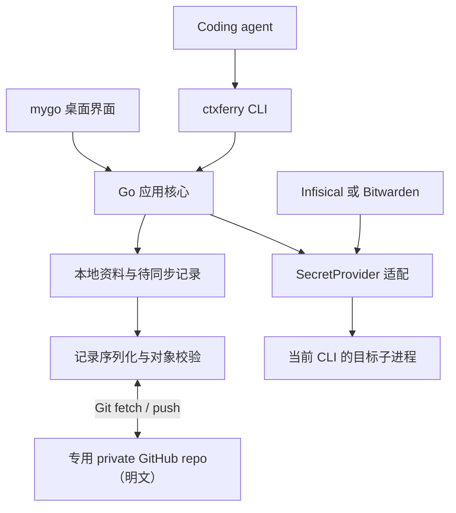
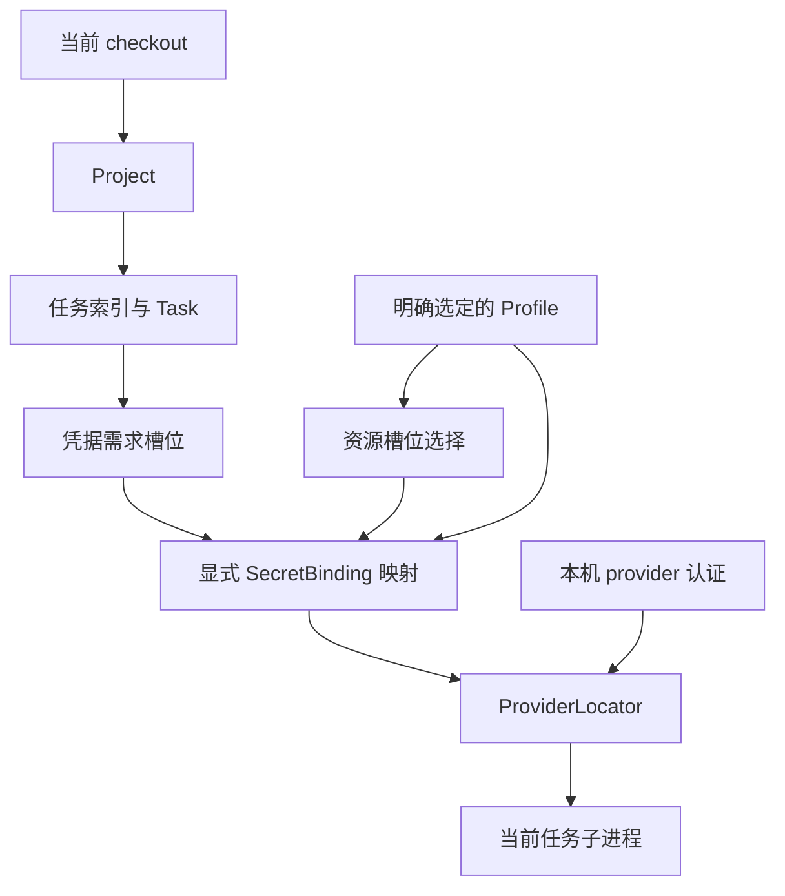

# CtxFerry 产品需求与设计

**CtxFerry** 是面向开发者与 coding agent 的跨机器开发上下文管理工具，命令行为 `ctxferry`。它让项目说明、资源配置、任务定义、凭据引用、Skills 和小型工作产物随逻辑项目保持一致，同时把本机路径、认证与执行权限留在当前设备。

产品采用本地优先架构：Go CLI 与共享应用核心、桌面管理界面、各机独立 SQLite、专用私有 GitHub 同步仓库，以及外部 SecretProvider。首版面向单用户多设备，不要求常驻协调服务器；共享资料以明文保存于私有仓库，不实现客户端内容加密。业务密钥值始终留在外部后端，不能托管到同步后端的资料标记为 local-only。

# 产品目标与边界

## 用户完成一件事的体验

开发者在一台设备登记项目说明、共享资源与凭据引用后，在另一台设备绑定同一项目，即可按任务发现所需资料，并通过本机授权取得资源访问能力。小型工作产物按项目和运行记录归档，不必反复向会话粘贴地址、凭据名称和文件位置。

核心体验由五项组成：

1. **项目识别**：从当前目录判断 Project、checkout、worktree 和执行环境。

2. **按需上下文**：短摘要与资料索引先返回，再按任务检索具体文档和资源。

3. **凭据使用**：同步 SecretRef；由本机向外部后端获取值，只注入目标子进程。

4. **小数据同步**：可离线读写，恢复连接后重试；冲突明确呈现。

5. **管理界面**：查看来源、设备覆盖、同步状态、凭据可用性、Skill 安装情况和产物目录。

开发机安装、数据库搭建、AI 订阅、模型代理、agent 会话数据库、harness 编排和远程任务调度继续由现有工具负责。本工具可安装自己的用户级同步进程，但首版不要求常驻服务器，也不管理用户业务源码仓库的 clone、分支和 worktree。

## 名称

CtxFerry 由 Context 与 Ferry 组合，表达在设备之间传递开发上下文。产品名使用 CtxFerry，命令名及路径前缀统一使用 `ctxferry`。

# 核心架构

## 本地能力与同步分开

每台设备安装同一套 CLI；桌面管理界面为可选入口。共享应用核心负责查询、解析、同步与 Skill 投影。每个 workspace 有独立的本地数据库和应用专管的 Git 仓库，Git 操作不进入业务源码 checkout。



GitHub 以明文保存已发布的记录快照、凭据引用、私有 Skill 包和受控小对象。业务数据库密码、API key、provider 登录 token 和 Git 认证凭据不进入仓库。业务密钥值由外部 SecretProvider 保管；密钥后端与 Git 身份各机独立认证，认证材料仅留本机或既有受保护后端。

人工导入的文档或日志仍可能夹带凭据。允许列表、结构化导入和扫描用于降低误入概率，不宣称任意输入永远不含秘密。

本地 context、GUI 与已安装 Skill 不以 GitHub 在线为前置；已下载并保存在本机的资料可离线读取。业务 secret 的离线可用性取决于 provider 和本机认证状态。查询结果显示最后同步时间、pending、stale 或 unknown，不把“有缓存”解释成“环境已就绪”。

首版采用单用户、多设备、一个 workspace 对应一个信任域。仓库读取权限覆盖整个仓库，拥有读取权限的账号和设备能够取得其中的明文内容。项目订阅只控制本机索引、展示、Skill 投影和 payload 缓存，不构成 ACL，也不承诺网络层的选择性下载。需要区分设备的数据访问范围时，应拆分 workspace、仓库和访问凭据；不能上传的内容保持 local-only。

## 仓库接入与本机认证

使用专用 private repo 和单个同步分支，例如 `ctxferry-v1`。首版复用系统 Git 的 SSH 或 credential helper；已有 gh 登录可使用其 Git helper。需要更小权限时，使用仅能访问同步仓库的 fine-grained PAT。复用个人 SSH 或 gh 凭据并不意味着它天然只有单仓库权限。[GitHub token 文档](https://docs.github.com/en/authentication/keeping-your-account-and-data-secure/managing-your-personal-access-tokens) · [gh Git helper](https://cli.github.com/manual/gh_auth_setup-git)

同步凭据只能供 Git/helper 使用，不写入 remote URL、同步文件、应用日志或业务子进程环境。连接检查把“Git 可访问”和“仓库确认为 private”分开；后者需要已认证的 GitHub 元数据读取，SSH clone 成功不能证明私有性。无法确认时保留本地可用状态，不自动首次上传。

备份分为已发布的明文 Git 历史与本地未发布状态。可用 git bundle 保存前者；后者使用一致 SQLite 快照及所引用的本地对象。首版不内置备份加密或资料解密钥匙恢复流程，备份应保存到用户指定的受保护位置，且不得包含业务密钥值和认证材料。local-only 内容只进入明确选择的本机备份，不进入同步仓库。

记录格式、稳定 ID、同步基线与对象引用独立于 Git。SyncBackend 负责快照读取、带精确前置条件的发布以及未知提交结果的查询；更换后端不改变 Project、Task 或 SecretBinding 的逻辑身份。

# 数据模型与信息作用域

## 共享目录与本机状态

| 逻辑对象 | 核心字段与关系 | 存放方式 |
| --- | --- | --- |
| Workspace | ID、schema、信任域、存储策略、provider 连接描述 | 允许同步的普通配置以明文共享；其余 local-only |
| Device | 一次独立安装或执行环境的 ID、名称、OS、架构、角色 | 最小描述可共享；认证不共享 |
| Repository | 稳定 ID、获认可的 remote aliases | 共享；不把 remote URL 当授权 |
| Project | 稳定 ID、slug、简介、仓库成员及子目录范围 | 共享；一个项目可含多个仓库 |
| CheckoutBinding | Device、Project、Repository、绝对路径、worktree、本机 profile 选择 | 仅本机 |
| ContextDoc | scope、用途、正文、来源、新鲜度、agent disclosure | shared 或 local-only |
| Resource | 服务身份、kind、stage、用途、非秘密端点、网络与平台条件 | shared 或 local-only |
| Task | 可执行能力的用途、输入、资源槽位、凭据需求、程序和 argv | 共享；执行信任留本机 |
| Profile | 场景参数、资源选择、Task 槽位到 SecretBinding 的映射 | 普通参数可继承，秘密映射显式选择 |
| SecretBinding | 可复用逻辑别名、资源、用途、类型、provider profile 和 locator | 只共享引用，不保存值 |
| SkillPackage / Install | 来源和版本 pin；本机投影、文件 ownership 与修改状态 | 包及意图可共享；安装状态分机 |
| Run / Artifact / Observation | 不可变运行身份、payload 与位置、独立平台观察 | 摘要与受控小对象共享 |
| LocalState | outbox、冲突、已确认 head、认证状态、信任摘要、缓存 | 仅本机，不进入 Git |

这是逻辑模型，不要求为每个名词建立独立服务或插件。CredentialRequirement 是 Task 内的具名槽位；ProviderLocator 是 SecretBinding 内的结构；ProviderProfile 是 Workspace 的小型连接配置集合。Task 就是可执行能力，不再另建一套重复的 Capability 实体。

Project 与 Repository 通过 membership 关联：monorepo 的多个子目录可以属于不同 Project，多仓库业务也可属于同一 Project。CheckoutBinding 记录这一关系在当前机器上的实际落点。Device 在这里表示独立安装／执行环境，Windows 与 WSL 各有一个；物理同机只作为可选分组。资源的 `stage=test/production` 则描述业务环境，不能与 Device 混用。

Task 选择明确的 Project–Repository membership，membership 指向稳定 Repository 和仓库内子目录。执行目录以该 membership 的项目根为基准，再解析 Task 中的相对 working_directory；不能直接沿用调用者当前子目录。若本机有多个可用 checkout/worktree，必须选择其中一个，解析结果进入本机执行信任摘要。

## 项目识别规则

推荐顺序：

1. 明确的 `--project`。

2. 本机显式路径绑定，按最长匹配目录选择。

3. 已绑定的 Git common-dir 和 worktree 归属。

4. 规范化 Git remote 作为候选，处理同一 GitHub repo 的 SSH、HTTPS 和末尾 `.git` 差异。

5. 有歧义时保持 unbound，并展示候选；不猜测。

采用稳定 UUID，slug 仅用于可读命令。仓库改名保留 alias；fork 与 upstream 可以在 UI 关联，但不能凭 origin 相似自动继承秘密。一个 Project 可关联多个 repo；monorepo 的不同子目录也可以显式绑定到不同 Project。

绑定默认保存在应用数据目录，项目无需新增受跟踪文件。非 Git 目录也允许显式绑定。Windows 与 WSL 使用不同 Device ID（独立安装／执行环境）；`C:\repo`、`/mnt/c/repo` 与 `/home/user/repo` 不能因指向相近内容就被当成同一可执行环境。

## 作用域与生效来源

对于允许覆盖的普通配置，采用固定解析顺序：

**全局默认 → 项目 → 明确选择的 profile → 本机覆盖 → 当前 checkout 的临时覆盖。**

Resource 的网络路线由当前 execution environment 解析。实测 Observation 作为独立事实显示，不自动覆盖用户意图。未知字段、类型冲突、多个候选值和缺失路径要明确报错。

这里的优先级只适用于 CtxFerry 的配置 schema。它不会改变 AGENTS.md、CLAUDE.md 或组织策略的指令优先级，也不授予数据库权限。SecretRef、执行命令、敏感级别和已批准 Skill 版本不能被宽松通配覆盖。

`context explain` 和 GUI 应返回：

| 字段 | 生效内容 | 来源 |
| --- | --- | --- |
| 当前 profile | development | Project |
| 资源 | shared-database | Profile |
| 本机 checkout | 当前设备绑定目录 | CheckoutBinding |
| 凭据可用性 | 本机认证状态及最近观察 | SecretProvider |

本机 localhost、凭据存储可用性、代理地址和可执行文件路径不得同步成所有设备共同的事实。资源的实际可达性由当前设备独立记录。

## 存储位置与模型可见性是两条独立轴

“不上 GitHub”不等于“不会发送给模型”。如果 CLI 把私人文档返回给使用云模型的 agent，该内容通常仍会进入那次模型请求。

建议每个资料条目分别声明：

- **存储与订阅**：local-only 永不上传；shared 进入所属 workspace，再按项目选择本地缓存与展示。订阅不是设备间访问控制。

- **Agent 输出方式**：正文可见、只给摘要或引用、本机工具消费而不返回正文。

具体默认：

| 内容 | 默认存放 | 默认给 agent 的形式 |
| --- | --- | --- |
| 开发约定、内网服务说明、项目私人设计 | 允许托管到 GitHub 的内容进入 private-plaintext workspace；其余 local-only | 按 disclosure 返回正文、摘要或引用 |
| 数据库密码、API key、业务私钥 | 外部 SecretProvider | requirement、SecretBinding 别名和可用状态 |
| Git 凭据、provider token、BW_SESSION | 本机受保护存储或既有外部后端；不入同步仓库 | 不输出 |
| 绝对路径、工具安装位置、当前 profile 选择 | 本机 CheckoutBinding / LocalState | 当前机器解析后的值 |
| 脱敏摘要与小型样本 | 按配额进入 workspace；payload 与 metadata 分开 | 摘要及按需获取 |
| 敏感原始数据、完整数据集、模型权重 | 本地或已有专用存储 | 获准共享的数据集 ID、版本、位置和状态 |

`local-only` 必须真实地阻止上传；扫描不能覆盖用户对数据类别的判断。私有材料的分类与首次导入在本机 UI 完成，扫描结果只展示字段名和发现类型，不回显可疑值。

## 资料的新鲜度

普通配置由显式编辑维护；设备探测只更新观察记录。上下文输出至少包含 `source`、`updated_at`、`observed_at`、`revision` 和 `stale/unknown` 标记。

第一版不读取 agent 会话数据库、不自动总结所有聊天，也不建立 reflection/dreaming 系统。agent 可以在明确要求下通过 CLI 写入项目资料；自动发现结果不能自行变成新的全局授权规则。

# 数据的物理组织与生命周期

## 三层存储及各自的事实来源

| 层 | 保存什么 | 不保存什么 |
| --- | --- | --- |
| 本机工作层 | 本机资料、查询索引、本机绑定、pending 修改、冲突、缓存与安装状态 | 不把业务密钥值做成通用持久缓存 |
| Git 发布层 | 明文版本化共享记录、必要小对象、协议标识 | 不上传 SQLite/WAL、认证会话、绝对路径绑定、运行锁、明文秘密文件 |
| 外部密钥层 | 数据库密码/API key 及对应认证机制 | 不由 CtxFerry 重新实现远程 vault |

Git 中最新有效 commit 是已发布共享状态；本机 SQLite 同时保存这一基线及尚未发布的工作，不能把未同步编辑当成可任意重建的缓存。外部 provider 是业务 secret 值的唯一事实来源。

有效上下文是由共享基线、本机改动、当前 Project/Profile/Device 计算出的派生视图。它不作为另一份“全局最终配置”同步，否则 Mac 的本机覆盖会再次扩散给 WSL。

## 一条记录一个文件

初版使用固定路径映射；实际文件名采用 UUID 或内容 hash，避免项目标题和服务改名引发路径变化。文件名不提供保密边界，仓库正文仍为明文。

| Git 路径 | 含义 |
| --- | --- |
| `workspace.json` | 最少协议元数据：format、workspaceId、epoch、storageMode（首版固定为 private-plaintext） |
| `records/<prefix>/<record-id>.json` | 单个共享实体的完整明文 envelope |
| `objects/<sha256>` | 按内容 hash 定位的小型不可变 payload；类型、大小和 hash 记录在 manifest 中 |
| `README.md` | 格式、明文存储边界与恢复说明 |

首版只实现 private-plaintext workspace，不引入 age、资料加解密 identity、密钥分发或恢复体系。单记录修改只重写该记录，未变化的 payload 按内容 hash 复用；无需将整个 workspace 打包后重新上传。

共享记录的 envelope 示意如下；ID 为可读占位，实际使用稳定 UUID，revision 也采用不依赖本机时钟的标识。

```json
{
  "schemaVersion": 1,
  "id": "record-id",
  "kind": "context",
  "workspaceId": "workspace-id",
  "scope": {"kind": "project", "id": "project-id"},
  "revision": "revision-id",
  "previousRevision": "previous-revision-id",
  "operationId": "operation-id",
  "deleted": false,
  "provenance": {"deviceId": "device-id", "updatedAt": "timestamp"},
  "policy": {"storage": "shared", "agentDisclosure": "summary"},
  "payload": {}
}
```

scope 表示资料归属与解析范围，不表示授权。provenance 用于追溯，不把可编辑的 deviceId 当成身份凭证。业务引用均指向稳定 ID；slug、标题和搜索关键词仅用于发现与展示。

## 本地数据库与文件

建议按平台标准应用数据目录保存，每个 workspace 独立：

| 本机内容 | 建议组织 | 是否可重建 |
| --- | --- | --- |
| 共享基线、工作稿及 outbox | `catalog.sqlite` 中的 typed records、pending operations 和基线 | 已发布部分可重建；未发布工作不能丢弃 |
| 本机路径与选项 | checkout_bindings、device_options、profile_selections | 不能从另一台设备直接恢复为正确路径 |
| 同步运行状态 | sync_state、pending_push、conflicts | 要保留提交结果未知及三方冲突证据 |
| 派生索引 | 项目／资源／任务索引与全文搜索 | 可重建 |
| Skill 与受控文件投影 | 文件 ownership、上次内容摘要、恢复记录 | 可重建受管内容；外部修改必须保留 |
| Git transport | 独立 managed repository，只 stage 显式生成的记录和对象 | 可 fetch 重建已发布状态 |
| Git 与 provider 认证 | OS 安全存储或用户明确配置的既有 headless 机制 | 按 Git/helper 和 provider 的认证机制处理 |

共享记录可以用统一 records 表保存 envelope 与经过 schema 验证的 payload，再为 project/task/resource 等建立索引；本机绑定、outbox、冲突独立建表。跨记录约束由应用在事务内验证：引用目标存在、类型匹配、scope 可用，Task 需求、Profile 选择与 SecretBinding 的 resource/purpose/type 相容。关系变更及其可发布依赖记录作为一个发布单元。共享记录的持久引用只能指向可发布的共享对象；本机资源通过本机显式绑定覆盖使用，同样验证用途、类型和执行信任。依赖闭包遇到 local-only 对象时，阻止有关发布或将该绑定保留本机，绝不自动扩大对象的同步范围。

本机工作层必须位于 managed Git 仓库之外，只将明确允许共享的记录与对象导出到 Git。明文同步不会放宽 local-only、凭据排除或执行信任规则；本机数据库、编辑器视图和提供给 agent 的正文仍受本机账号及磁盘保护。

## 明文同步边界与接入

| 资料边界 | 首版处理 |
| --- | --- |
| 允许 GitHub 托管正文，但不公开、不混入业务源码仓库 | 专用 private repo 明文同步 |
| 不希望 GitHub 持有正文，或内容不能离开本机／内网 | local-only，不进入同步仓库 |
| 数据库密码、API key、业务私钥 | 外部 SecretProvider；只同步允许共享的引用，不同步值 |

private repo 提供访问控制，不提供针对 GitHub 平台的端到端内容保密；获得仓库读取权限的人或设备也能读取正文。Git 传输继续使用 SSH 或 HTTPS，此处取消的是 CtxFerry 的客户端内容加密。

本机接入配置只需记录 Git remote、workspace ID、同步分支和已确认的仓库身份；Git 认证由系统 Git/helper 管理，不把 token 写入这些配置。资料同步不依赖登录业务 SecretProvider，只有需要使用业务凭据时才建立对应认证。

首次加入按如下顺序：建立 Git 认证 → 验证仓库身份与私有性 → fetch 并校验共享目录 → 绑定本机 checkout → 按需建立业务 provider 认证。首次初始化本地资料不要求完成这一整条链，启用远端同步时才执行。

已下载的资料与本机未发布工作可在离线冷启动后继续读取；未取回的对象仍需恢复网络后获取。恢复依靠可用的 Git 历史、git bundle 和本地快照，不需要资料解密钥匙。业务 secret 仍按 provider 的离线能力处理，不新增通用持久缓存。

epoch 只表示同步历史代际，用于识别整个 workspace 从旧备份恢复等历史切换；它不表示加密代际。撤销设备的 Git/provider 凭据不能远程抹除已下载的明文历史、本地资料和业务凭据缓存。

# CLI 与全局 Agent 入口

## 命令面

| 命令组 | 拟议命令 | 用途 |
| --- | --- | --- |
| 上手 | `init`、`join <git-remote>`、`doctor` | 本地可用、接入仓库、检查当前环境 |
| 项目 | `project bind .`、`project list`、`project inspect` | 绑定并识别项目 |
| 上下文 | `context show`、`get`、`search`、`explain` | 摘要、定向读取、发现和来源 |
| 资源 | `resource list`、`inspect`、`check` | 找到资源、查看用途、显式探测 |
| 任务 | `task list`、`task inspect`、`run <task>` | 发现能力及需求，运行登记入口 |
| 凭据 | `secret list`、`secret status`、`secret bind`、`provider login` | 只查询绑定元数据，管理本机认证 |
| 临时执行 | `exec --task … --profile … -- <program> <args>` | 仅在 Task 明确允许自定义命令时使用 |
| 技能 | `skill add`、`plan`、`apply`、`update`、`rollback` | 固定来源、预览和部署 |
| 产物 | `artifact add`、`list`、`fetch`、`inspect` | 登记、发现与获取小型结果 |
| 同步 | `sync`、`sync status`、`sync resolve` | 追赶、诊断和处理冲突 |
| 维护 | `workspace backup`、`sync install-service` | 备份及本工具用户级同步进程 |

查询和管理命令支持 `--format json`，stdout 只返回一个稳定 schema 的 JSON 对象，诊断写 stderr。`run` 和 `exec` 的机器模式使用 `--format jsonl`：stdout 只发送 start、stdout、stderr、result 等 JSONL 事件，经处理的子进程输出放在事件字段内，不与裸输出混合。每个输出事件限长，并支持总输出预算；省略内容时在最终 result 明确标记 truncated。普通终端模式继续流式显示经处理的子进程输出。执行命令保留子进程退出码，控制面问题在结构化错误中标明 origin，避免和测试失败混淆；执行命令收到不支持的 `--format json` 时给出参数错误与正确用法。

`context show` 默认只给当前 Project 的摘要、执行环境、资料索引、资源用途和任务入口，建议默认不超过 8 KiB 文本。`get` 和 `search` 再拉取具体内容。索引使用本地 SQLite 搜索即可，首版无须向量数据库。

`doctor` 检查 CLI 是否可用、绑定是否存在、path 是否解析成功、当前认证状态、最近同步和必要依赖；不通过 `env` 全量输出环境，也不把 TCP 可连等同真实库已通过验收。

Task 表达可执行能力；`run` 使用已登记的 argv，`exec --task` 只在该 Task 明确允许自定义命令时可用，两者都解析同一组凭据需求。执行发生在调用 CLI 的进程内，同步后台进程不提供执行 RPC。允许任意目标程序时，目标程序能够读取或外传注入凭据，Task 契约不构成 OS 隔离。

## 全局 Skill 与短引导

为每种已接入工具安装一个短的 ctxferry Skill，并在全局指令文件增加受管理的引导块。先展示变更，再保留现有内容；重复安装幂等，卸载仅移除自己添加的块和文件。

Skill 只携带协议说明与少量例子，不复制全部私人资料，也不包含 provider token。凭据值不会作为 Skill 参数。是否触发 Skill 仍取决于 agent 行为，因此全局引导与清晰的 CLI 名称共同提供入口，不宣传模型永远自动执行的保证。

# Agent 如何发现和使用凭据

## 名称从项目目录来，不从整个 vault 猜测

Agent 首先知道的是当前项目可做什么。`context show` 自动汇总 Project 的 Task、Resource、ContextDoc 索引和本机选定 Profile；不需要为了生成索引登录或枚举整个 vault。

名称有四层：

| 层 | 示例 | 责任 |
| --- | --- | --- |
| 任务 slug 与语义关键词 | integration-check | 发现任务 |
| Task 内的凭据槽位 | database | 表达需求及状态 |
| SecretBinding 逻辑别名 | service.development | 建立明确绑定 |
| 后端定位与交付变量 | provider locator 与 DATABASE_URL | resolver 定位，Task 定义交付方式 |

后端条目名可以与环境变量名不同。两个项目都使用 `DATABASE_URL`，不代表它们应取得同一个值。

## 按确定关系解析



Profile 分别保存 `(taskId, resourceSlotId) → resourceId` 与 `(taskId, requirementId) → secretBindingId`；SecretBinding 本身独立，因此两个项目可以显式复用同一绑定。两个映射的槽位都限定在 Task 内，resourceSlotId 与 requirementId 无须同名。运行前比较 requirement、选中 Resource 与 binding 的用途、类型和资源 ID。普通配置可以继承；凭据选择不能由模糊关键词、时间戳或隐式同名覆盖决定。

全文搜索只帮助发现允许展示的项目资料、任务标题、别名和标签，不触发凭据取值，也不自动决定执行账号。

如果只是询问项目约定，停在 context get；如果只是查询服务用途，停在 resource inspect。不能因为资源被提及就获取凭据。

## 谁配置这些关系

首次 onboarding 从现有测试文档、脚本契约和用户选中的 env 文件形成候选 Task 与变量需求。GUI 让配置者选择资源用途及后端条目，生成 SecretBinding，再将槽位映射到该绑定。环境变量名是导入线索，不是确定值的唯一依据；含脚本求值的文件不自动执行。

一次绑定后，任务与逻辑引用跨机同步。新机器只需要 checkout 绑定和本机 provider 登录，不需要重新告诉每个 agent 会话该搜哪个 key。后端条目改名时调整 locator；更换 provider 时调整 binding，Task 槽位与交付变量可以保持稳定。

## 不足条件的明确状态

| 状态 | 含义与行为 |
| --- | --- |
| project-unbound | 展示候选，完成本机绑定后才允许凭据执行 |
| profile-required | 多个场景均适用，展示资源用途差异；不猜默认 |
| binding-missing | 报告 task/slot，给出 GUI 绑定入口；不搜相似 secret 替代 |
| binding-conflict / incompatible | 映射冲突或资源／用途／类型不匹配，阻止相关执行 |
| authentication-required | 本机需登录或解锁，不同步其他机器的 token |
| secret-unavailable | 条目不存在或无权限，报告不含值的诊断 |
| platform-unsupported | 当前 Task 不适用于该 OS；Windows 不自动冒充 WSL |
| resource-unreachable | 诊断当前网络，不自动换成本机同名数据库 |
| execution-definition-changed | 执行内容或映射改变，在已有配置更新预览中启用新版本 |

“已绑定”“已认证”“条目可取”“资源可达”“测试通过”分别记录。单个绿色图标不能代替这些状态。

# 密钥后端与运行时使用

## 后端适配边界

SecretProvider 将凭据后端与项目配置解耦。首批适配以 Infisical 和 Bitwarden Password Manager 为目标，外部后端负责秘密存储、身份与权限；CtxFerry 负责引用解析和受控交付。不同后端的登录、解锁、机器身份和离线能力分别报告，不承诺完全相同的体验。后端真实访问权限不得由本地 profile 过滤替代。

## 从凭据需求到后端引用

SecretRef 在完整模型中由 SecretBinding 表达：它是可复用的逻辑引用，包含资源、用途、凭据类型和结构化 ProviderLocator。Task 内的 CredentialRequirement 只表达需要什么，Profile 显式连接两者。以下是逻辑视图，ID 为可读示意，各对象实际分记录保存。

```yaml
task:
  id: task-integration
  slug: integration-check
  project_id: project-example
  resource_slots:
    database: {kind: database, stage: development}
  credential_requirements:
    database:
      resource_slot: database
      purpose: application-runtime
      type: connection-string
      delivery: {env: DATABASE_URL}
  execution:
    repository_membership_id: member-example-root
    working_directory: .
    argv: [scripts/integration-check]
    allow_custom_command: false

profile:
  id: profile-development
  resources:
    task-integration/database: resource-shared-database
  credential_bindings:
    task-integration/database: binding-development

secret_binding:
  id: binding-development
  resource_id: resource-shared-database
  purpose: application-runtime
  type: connection-string
  provider_profile_id: provider-development
  locator:
    project_id: backend-project-id
    environment: development
    path: /application
    key: DATABASE_CONNECTION
```

Task 的 repository membership 指向项目内明确的仓库与子目录，程序从对应的本机 checkout 和工作目录执行，而非任意调用目录。

Resource 的 stage 描述业务用途，provider locator 的 environment 描述后端命名空间，二者不得隐式等同。后端 key 与子进程变量名独立；绑定标签不能替代目标服务本身的账号与用途限制。后端支持稳定条目 ID 时优先使用 ID。

资料库内不保存原始值，也不保存 provider 登录 token、BW_SESSION、解锁主密码或私钥。首次迁移可以封装已有 provider 的 import 操作，在本机只显示字段名和目标映射；默认不扫描或收集整台机器的 secrets，也不自动删除原文件。

## 执行流程

1. 识别当前 Project、profile 和任务用途。

2. 检查本机是否已启用当前 Task／Profile 的执行配置版本、资源适用条件及 provider 认证状态。

3. 仅解析当前任务需要的 SecretRef。

4. 值在 Go adapter 内部或 provider 原生执行路径中处理。

5. 用程序名、参数数组和 child environment 启动目标程序。

6. 返回退出码和经处理的结果；保留可定位问题的诊断，不粗暴丢弃全部 stderr。

凭据值不得拼接到 shell 字符串、命令参数或临时 shell profile，也不得把整个 agent 主进程放入含全套项目凭据的环境。Git 和 provider 自身的认证材料不得继承给业务子进程。

只有能限制注入集合并排除认证材料的 provider 原生执行路径才可使用；否则由 adapter 内部取值并构建明确的 child environment。run 与 exec 均在当前调用者的 CLI 进程中执行，不把任务交给可能具有不同权限的同步 daemon。

本机信任记录绑定已审阅执行字段的摘要或版本，包括程序、参数、Repository membership、解析后的本机 checkout 与工作目录、所选 Profile 的凭据映射、SecretBinding 的 provider profile／locator 版本及资源用途。同步到这些字段的新版本时，在既有配置变更预览中启用后再用于凭据执行；普通说明更新不影响已启用状态，也不需要每次运行再次确认。`exec --task` 只在该 Task 允许自定义命令时可用；此时目标程序仍能读取已注入的值，不能据此声称具备 OS 隔离。

首版主要支持环境变量型凭据。需要私钥签名、证书文件或特定文件注入时，优先使用外部 provider 已有的 SSH agent、文件或身份能力；不以通用“导出整个钥匙串”解决。

## 能保证什么

默认查询、日志和 GUI 数据接口不返回秘密值。标准执行路径应降低凭据意外进入模型上下文、命令历史和共享资料的概率。

目标程序取得环境变量后，仍可以读取、编码、打印或发送它们。拥有相同 OS 用户和任意执行能力的 agent，也不能仅靠提示词、文件 ignore 或输出遮罩被严格隔离。更强的保证需要外部 provider 的真实权限、独立运行身份或已有 credential broker。CtxFerry 第一版不自建这一基础设施。

## 离线与撤销

上下文离线是产品能力；secret 离线按 provider、认证方式和版本报告。

- SecretProvider 分别报告登录、解锁、会话有效期和离线读取能力；不能用单个 available 状态掩盖这些差异。

- 交互认证与机器身份分别建模。每台设备独立认证，不跨设备复制后端会话。

- 第一版不为统一体验新增持久化通用秘密缓存。

设备丢失时分别撤销其 GitHub 访问、provider 身份或会话，并按实际暴露情况轮换业务凭据。撤销不能抹除已经交给进程的值、离线缓存及已 clone 的明文历史；应将这些本机副本视为已暴露范围的一部分。

# 同步协议与恢复

## 第一版采用记录同步

各机持有独立 SQLite 和 outbox；专用 Git 同步分支保存已发布共享快照。应用在自己的 managed repository 中 fetch 和生成提交，不在用户源码目录运行自动 pull/merge/add。不同机器不复制活跃 SQLite、WAL、锁文件或会话数据库。

一轮同步同时使用记录基线和仓库基线。前者识别同一实体的并发修改，后者使整批变更在一个 commit 中发布。待提交操作保存：

```json
{
  "operationId": "operation-id",
  "baseEpoch": "workspace-epoch",
  "baseRecordRevision": "record-revision-id",
  "entityId": "record-id",
  "changes": {},
  "publishAttempt": {
    "baseHead": "expected-git-commit",
    "candidateCommit": "new-git-commit"
  }
}
```

同步器取得本机 owner 锁并 fetch，记录远端 head H，校验 workspaceId、epoch、schema 和 storageMode。将待发布操作与 H 中各记录的基线比较；无并发修改才应用。有依赖的记录保持同一提交单元，互不相关的记录可继续同步。

生成候选 C 后必须验证其唯一 parent 正是 H，再用显式 expected-head 的 Git lease 发布。可使用 `--force-with-lease=refs/heads/ctxferry-v1:<H>`，但候选始终只能追加，禁止重写历史、普通 --force、+refspec 和 mirror。普通 non-fast-forward 检查与精确比较旧 head 不是同一个契约。[Git push 文档](https://git-scm.com/docs/git-push)

发布前持久化 pendingPush，包括 H、C 和 operation IDs；连接中断、结果未知时先检查 C 是否已在远端历史，再决定重试。并发拒绝后重新 fetch 并比较业务基线，不以 Git 文本 rebase 或 merge 代替业务冲突判断。客户端时钟仅作展示，不决定胜负。

首次初始化是独立的显式操作：仓库身份与私有性核验通过，且用户选择 init 后，才以 expected-absent 前置条件创建同步分支，生成初始 root commit；可使用空 expected 值的 `--force-with-lease=refs/heads/ctxferry-v1:`。若其他客户端已创建该分支，初始化失败后读取并核对既有 workspace。首次发布同样保存 pendingPush，处理创建成功但响应丢失。日常 sync/join 发现分支缺失仍按异常处理，不能自动覆盖或新建。

先生成并校验 payload 对象，再把其引用和对应记录一起加入候选 Git tree；单次分支推进发布完整快照。本地下载同样先暂存、校验内容 hash、schema 与引用，再在数据库事务中切换可见状态。半个文件、损坏对象或未知 schema 不成为“已同步”内容。

## 冲突规则

第一版做到 CAS 和冲突保留即可，无需立即实现通用 CRDT：

- 不同实体独立提交。

- 同一实体的并发变更返回明确冲突，保留 base、local、remote 三份内容。

- 用户通过 CLI 或 GUI 选择一边或编辑新版本。

- 后续可在应用层合并明确不重叠的普通字段；首版即使采用明文 JSON，也不以 Git 文本自动合并代替记录级冲突处理。

- SecretRef、资源用途、执行参数、敏感级别、已批准 Skill pin 的冲突始终要求明确选择，不按时间合成。

- 删除使用 tombstone。首次版本不自动清理 tombstone，避免长期离线设备复活已删记录。

- 不完整目录读取、权限错误和超时不是“远端为空”，绝不据此进行清空。

恢复某条历史内容优先创建新的记录版本并追加提交，不 reset 同步分支。发现远端 head 不再延续已确认历史时进入 history-rewritten，保留本机工作并停止自动发布。确需从旧备份恢复整个 workspace 时，显式建立新 epoch；旧 outbox 保留原基线，经比较后重建操作或形成冲突。

## 状态可解释

统一显示 synced、pending、conflict、offline、auth-required、unlock-required、incomplete、unsupported-schema 和 history-rewritten。缺 payload 或超限时显示 incomplete / metadata-only；远端 404、分支缺失或认证错误不解释成空 workspace，也不自动初始化覆盖。

普通同步对网络错误指数退避；权限拒绝与不兼容 schema 不无限重试。新客户端不能理解的写入 schema 应只读或拒绝写，避免丢掉未知字段。

默认采用提交后触发同步，加轻量后台追赶。首版提供本工具自己的用户级 `ctxferry sync serve`；onboarding 可通过 `ctxferry sync install-service` 安装随用户会话启动的后台进程。每个本地 store 只有一个同步 owner，以本地进程锁约束。CLI 和 GUI 提交本地事务与 outbox，不同时启动多个网络同步器；显式 `sync` 若遇到已有 owner，就等待其进度。没有安装服务时，CLI 可以取得同一锁完成一次同步，下一次调用继续处理离线队列。Skill 投影等文件修改另有操作锁和中断恢复记录。

同步提交做短时间合并与退避，不按每次按键或日志行 push。GitHub 的推荐 push 频率不是目标吞吐；多个设备共享一个仓库，应按小规模资料变更调度。[仓库活动限制](https://docs.github.com/en/repositories/creating-and-managing-repositories/repository-limits)

后台服务无需 GUI 或 WebView；UI 关闭后仍能继续同步，机器休眠或用户会话终止则暂挂，恢复运行后追赶。WSL 没有可用用户服务管理器时，明确显示仅在前台或调用时同步，不伪报后台常驻。上下文查询优先返回本地数据，明确给出最后同步时间；需要最新状态的操作可以显式等待同步。

# Skill 管理

第一版选择“少量可靠来源 + 固定版本 + 可解释投影”，不建设自己的 Skill 市场。

| 能力 | 行为 |
| --- | --- |
| 导入 | Git 仓库、明确本机目录；包只含所选 Skill 及资源 |
| 版本 | 保存源 URL、子目录、commit 或 release、内容摘要与许可证 |
| 分组 | 全局、项目、设备能力组，例如 development、review |
| 部署 | 默认物理拷贝；可选已验证的 symlink；目标目录由工具 adapter 决定 |
| 更新 | 先比较来源和本地修改，再展示 diff；不默认追 main 静默覆盖 |
| Ownership | 记录已安装的文件及上次摘要；只删除自己拥有且未被外部修改的内容 |
| 回滚 | 保留已安装的前一版本；失败后回到完整版本 |
| 跨平台 | 可执行位与平台要求纳入 manifest；Windows 和无依赖机器显示不适用原因 |

公共 Skill 可以继续由 GitHub 提供源；同步的是 pin、选择和缓存包。私人 Skill 从 CtxFerry 同步存储分发。本机安装状态与可携带的启用意图分开，不将 Mac 的绝对 symlink 目标发给 WSL。

发生同名碰撞、外部编辑或缺失依赖时，`skill plan` 返回差异。没有明确所有权的目录不会被删除或覆盖。更新默认不执行任意 post-install 脚本；Skill 的可执行内容与普通资料区别管理。

建议首批仅支持 Codex 和 Claude Code 的稳定用户入口，再根据真实需要添加 Cursor 等工具的文件适配。静态文件部署不涉及会话管理，不访问 agent 内部数据库。

# 小型 Artifacts

## 管理运行记录

Artifact 是一次运行或一次观察的产物，不是一个会被所有机器覆盖的 `latest.json`。

manifest 建议包含：

- project ID、run ID、创建设备、创建时间；

- 受测源码 revision；有未提交改动时明确记录 dirty 状态与已有 diff 标识；

- 执行 profile、OS 与架构、相关工具版本；

- 输入样本或数据集 ID、模型 revision 等复现所需身份；

- 原命令、退出码、摘要、已完成范围、未完成范围；

- payload 的类型、大小、hash、敏感分类和存储位置。

只记录有追溯价值的信息，不递归哈希整个 SDK、缓存或工作目录；已有结构化产物格式可通过适配复用。

## 建议默认配额

以下是产品设计默认值，不是基础设施限制：

| 对象 | Git 首版默认策略 |
| --- | --- |
| 结构化 context 记录 | 256 KiB |
| Markdown 正文 | 1 MiB，频繁大文档可拆分 |
| 自动同步 artifact | payload 原始字节不超过 1 MiB |
| 显式选择的小样本 | 可允许到 5 MiB；展示历史体积影响 |
| 单次常规变更包 | 建议不超过 5 MiB |
| 本机 artifact 缓存 | 默认 1 GiB，可调整 |
| Git 历史增长 | 约 100 MiB 提示；约 250 MiB 暂停新增自动 artifact，普通 context 继续 |
| 超限内容 | metadata-only，payload 保留原位置 |
| 权重、数据库 dump、敏感原始数据 | 不自动纳入 |

产物通过允许列表和明确的 `artifact add` 登记。可以配置同步已知格式的脱敏报告；不默认递归监听整个 `artifacts/` 目录，也不把已有大型 LFS 内容复制一遍。

Git 会保留被历史引用的旧明文记录与对象；删除当前 payload、限制本机缓存或运行 gc 不会自动清除这些历史。日常同步复用内容 hash 未变化的对象，避免重复写入扩大仓库。误提交凭据时须按实际暴露情况撤销或轮换，删除最新版本不能消除泄露。首版不自动启用 LFS，不重复收纳已有大型归档。

支持小型结构化摘要、图片、文档和必要样本。默认排除原始完整日志、含大量个人路径的转储、认证报文和数据集正文。每条 Observation 保留设备、工具、时间及实际观察范围；传输成功不等于在目标设备完成检查，新增观察不得覆盖已有结论。

# 图形界面与上手流程

## 界面信息架构

桌面界面围绕资料、绑定与同步管理，不包含 agent 聊天、订阅或模型代理面板。

| 页面 | 关键内容与操作 |
| --- | --- |
| Overview | 当前设备、已绑定项目、pending、冲突、Git 与 provider 认证状态 |
| Projects | checkout、Context、Resources、Tasks、Profiles、Skills、Artifacts |
| Fleet 与 Resources | 执行环境、服务用途、访问路线和最近观察 |
| Secrets | Task 需求槽位、复用绑定、provider 认证、定位元数据；跳转后端管理 |
| Skills | 来源和版本、安装目标、差异、本地修改与回滚 |
| Artifacts | 项目/run 过滤、来源设备、完成范围、大小及位置 |
| Sync | private repo、分支、明文存储边界、最后 head、pending、冲突、历史体积与备份 |

项目配置编辑器必须区分“直接编辑的值”和“当前继承的值”。每项提供“来源”和“重置为继承”；某机器不适用时显示原因。SecretRef 不使用可展开查看明文的通用 JSON inspector。

冲突界面展示 base、local、remote，并说明哪台机器修改。处理后产生新 revision；不会让用户猜测“哪个 sync-conflict 文件才对”。

## 首台机器

`init` 应先完成本地可用，不以登录任何后端为前置。GUI 和 CLI 使用同一份 onboarding 状态，过程可中断后继续。

推荐流程：

1. 选择现有项目目录；默认只读 Git remote、目录和少量明确工具信息。

2. 预览识别出的 Project；绑定本机路径。

3. 选择需要的 global Skill 和引导文件，预览受管理块。

4. 选择 Infisical 或暂不配置；认证由本机交互完成。

5. 选择要导入的私人说明；秘密文件走独立 provider 导入流程。

6. 选择专用 private GitHub repo；核验私有性，预览将以明文上传的内容，确认 local-only 和凭据已排除。

7. 执行一次 `doctor`，展示哪些能力现在可用。

不默认读取整个 shell history、agent 会话、所有环境变量或网络服务器清单。

## 第二台机器

1. 安装 CtxFerry。

2. 输入 private Git remote，完成本机 Git 认证并验证仓库身份与私有性。

3. 直接取回并校验共享目录；需要使用业务凭据时，再完成本机 provider 认证。

4. 选择项目订阅，绑定本机 checkout 和所需 profile；已有 Task 槽位映射随目录取得。

5. 安装所选全局 Skill，展示任务索引、绑定与认证状态；秘密值不进入引导文件。

在已有 Git 与 provider 账号的情况下，新设备的产品体验目标是约 5 分钟完成项目接入。首次第三方账号认证及依赖安装独立于该目标。

Windows 与 WSL 分别完成本地绑定。UI 可以将它们显示为同一物理主机下的两个执行环境，但不能自动共用 Windows Credential Manager 和 Linux keyring 的凭据状态。

# 技术设计

本地存储采用 SQLite，CLI 与 GUI 共用 Go 应用核心，桌面界面采用 MyGo Native UI，以 Go 构建视图和控件，并在进程内调用共享应用核心。数据库使用 WAL、短事务和明确的 busy timeout。文件投影先暂存并记录恢复状态，再切换目标；磁盘写入失败不得记为成功安装。

首版不发布 Hub HTTP 服务。CLI 与 GUI 共用 Go app 层；同步进程只做数据同步，不接收远程命令或代替 CLI 执行凭据任务。系统 Git 用参数数组调用；managed repository 不执行远端内容提供的 hooks / filters，也不递归 stage 任意目录。Git 和 agent 业务子进程使用分开的环境构建策略。

## 关键扩展接口

核心通过以下接口隔离不同后端和工具的适配：

- `ContextResolver`：Project、scope、profile、device 的解析与 explain。

- `SecretProvider`：认证状态、能力描述、按引用解析并向执行路径提供值。

- `SyncBackend`：读取发布基线、取得快照、带精确前置条件提交及查询未知提交结果；Git 是首个实现。

- `CredentialStore`：本机 Git/provider 认证凭据；不参与资料同步。

- `SkillTarget`：工具入口发现、生成安装计划、受控投影。

- `ArtifactStore`：manifest 与小对象登记、完整性和获取。

SecretProvider 的能力要按认证方式返回：`machine_auth`、`offline_read`、`native_exec`、`file_delivery`、`session_expiry`。不通过一个“available=true”掩盖不同后端的限制。

CLI 不直接依赖 GUI 生命周期或 GUI 初始化。可使用同服务名的 OS credential adapter，或 provider 自己的认证存储；headless 的受保护注入、交互解锁或系统已有 credentials 机制需在 doctor 中明确说明。没有可用安全存储时，不得静默降级为明文 token 文件。headless 可以使用用户明确配置的既有受保护 credentials 注入机制；这些认证材料不进入资料同步、应用导出或诊断包。

GUI 使用应用自带的原生界面资产，将资料正文和差异作为数据展示，外部链接由系统浏览器打开。核心 CLI 在无 DISPLAY、无 DBus、无 WebKitGTK 的 Linux 上仍可运行，provider 不可用要返回明确的认证或能力状态。
