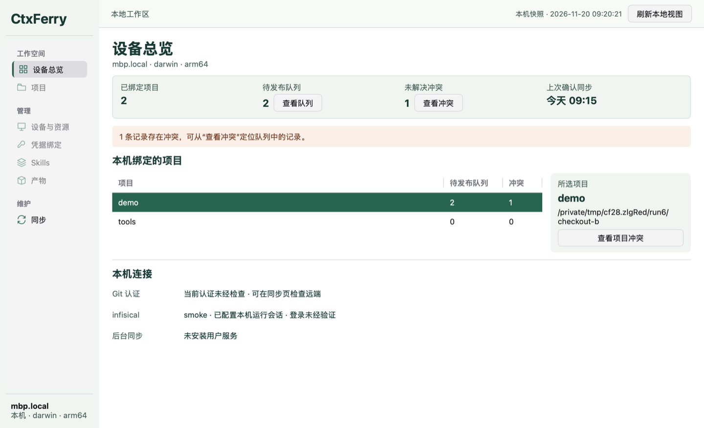
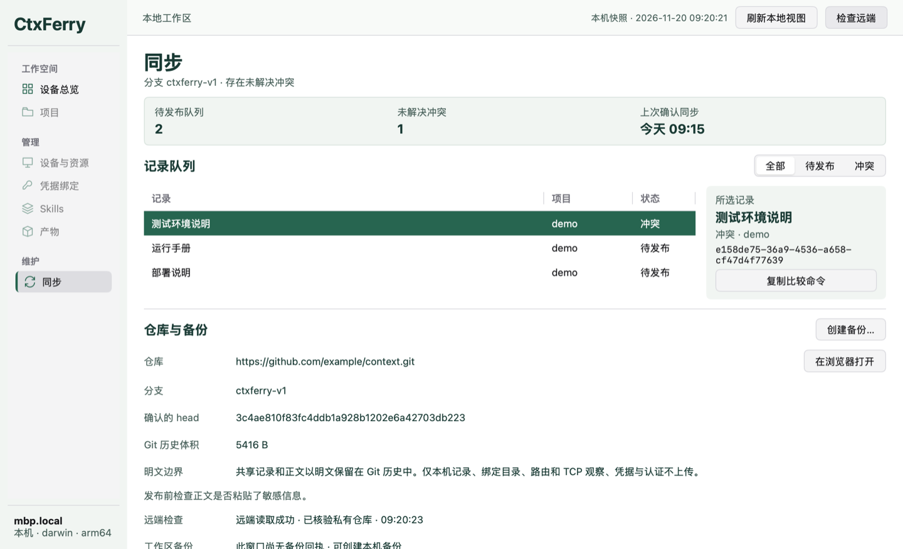

The desktop opens the same local Workspace as the CLI.
**设备总览** (Overview) shows this device's Projects and sync health. **同步**
(Sync) lets you inspect queued records, check a configured remote and create
a local backup. Publishing shared records runs through the CLI or sync service.

## Start the viewer

Use a desktop session supported by the native UI and a Go toolchain compatible
with `cmd/ctxferry-desktop/go.mod`. From the CtxFerry repository root, run:

```sh
cd cmd/ctxferry-desktop
go run .
```

The desktop is its own Go module and refers to the surrounding checkout's
application core. The window opens with **设备总览** selected.

To inspect an isolated Workspace, set the same data root for both CLI and
viewer. For example, in separate shells on macOS or Linux:

```sh
export CTXFERRY_DATA_DIR=/path/to/isolated-ctxferry
ctxferry init
```

Then start the desktop from `cmd/ctxferry-desktop` with that same environment:

```sh
go run .
```

The desktop honors `CTXFERRY_DATA_DIR`; passing `--data-dir` only to a CLI
command does not change the viewer's location. Initialize and bind through the
CLI first if the viewer reports **尚未初始化工作区**.

## Read Overview



This macOS example has two bound Projects, two records waiting to publish and
one unresolved conflict. Select a Project to inspect its bound directories.
Choose **查看队列** or **查看冲突** to open the corresponding records in Sync.
The desktop counts conflicts separately from the pending queue.

Choose **刷新本地视图** after a CLI operation to reread local state. The last
confirmed sync time, service state and locally available authentication evidence
help you decide whether to run an active check. Use [Diagnostics](diagnostics.md)
to check one credential mapping or diagnose a service.

## Edit Project configuration

Choose **打开项目** from Overview, or open **项目** and select the Project.
Choose a local Checkout if the Project has several bindings. The Profile
picker saves your choice for that Checkout on this device.

Open **配置** and select a field. The source list shows the workspace default,
Project, Profile, device and Checkout layers in inheritance order. Choose the
write layer in the inspector. Preview an edit or **预览恢复继承…** before
confirming. The preview identifies affected local Checkouts and the values
they retain or adopt. Shared layers become eligible for publication through
the normal sync workflow.

After confirmation, the configuration table reloads. From the same Checkout,
run `ctxferry context explain` to inspect the effective value and origin in the
CLI. See the [ordinary configuration guide](context.md).

## Read Sync



This is the same test Workspace. For a configured repository, inspect the
branch, confirmed commit and measured Git history size. Select **检查远端** to
check Git reachability and repository privacy. Filter the queue and select a
record for its details. For a conflict, copy the CLI comparison command and
follow [Conflict resolution](recovery.md#resolve-a-record-conflict).

For a new Workspace, follow the on-screen terminal commands to configure a
private repository, preview the shared plaintext and confirm first publication.
See [Private sync](sync.md) for the prerequisites and how to review the preview.

## Create a local backup

In **同步**, choose **创建备份…**. Enter an absolute path to a new directory,
review whether to include local-only data, and confirm the write. Backups are
plaintext. The receipt identifies the destination and its `manifest.json`.
[Recovery](recovery.md) explains the contents and how to restore them.

## Handle viewer states

| Desktop message | Next step |
| --- | --- |
| **尚未初始化工作区** | Run `ctxferry init` with the intended data root, then refresh. |
| **本机目录需要升级** | Use a matching CLI to open and migrate the catalog, then refresh; the viewer does not migrate it. |
| **本机快照不可用** | Run `ctxferry doctor --format json` and inspect the catalog evidence. |

## Map and check credential references

In **凭据绑定**, select the Project, Profile, Task and requirement slot.
Select **映射共享绑定…** or **更换共享绑定…** to reuse a compatible reference
or enter a new provider locator. Review the affected slot and alias before
saving. Publish the shared mapping through your usual sync workflow.

The inspector identifies the current execution environment and provider
profile. Use **检查本机认证** to check that session, then **检查条目可读性** to
check the referenced entry. **更新本机会话** adopts the provider session
configured in that environment. Entry values stay within the provider
adapter. Use the provider link and displayed locator to manage the entry.
[Credentials and Tasks](credentials.md) covers provider setup.

## Inspect environments and probe a resource

In **设备与资源**, select a Project, Resource and execution environment.
The page shows the Resource's purpose, stage, configured endpoint,
applicability and recent observations. The local route includes any
device-specific endpoint, proxy or network recorded through the CLI.

Choose **在本机探测 TCP…** to review the exact host, port and environment
before connecting. The result records TCP reachability for that target.
A proxy route checks the proxy port. Each remote environment displays its
own available observations and reports its provider session as unknown.
[Tasks and Resources](tasks-and-resources.md) covers local route setup.

## Planned desktop scope

The desktop roadmap includes Skills and Artifact management.
[Skills and Artifacts #32](https://github.com/whynpc9/CtxFerry/issues/32)
