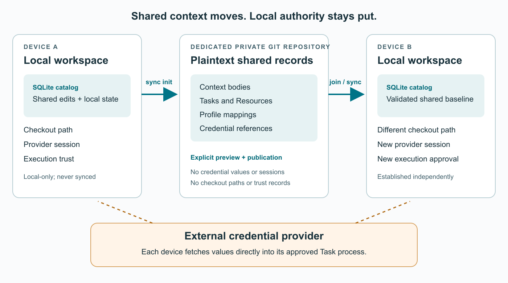

English · [简体中文](zh-CN/tutorial.md)

You use Claude Code, Codex, Cursor or Pi on two machines against the same
source project. Some private environment notes and agent instructions do not
belong in source Git, and an API credential should not be pasted into agent
chat. CtxFerry lets each agent discover the context you approve and run a
registered, credentialed Task while you keep control of publication, provider
login and execution trust.

In this walkthrough, a human creates one shared note and one standalone API
credential reference on device A. A coding agent then finds that note and runs
the Task without handling the raw token. Private sync carries the note, Task
and credential reference to device B, where the human establishes local login
and trust before the agent repeats the workflow.



CtxFerry synchronizes **development context and credential references**, not
credential values, provider sessions, checkout paths or execution trust. Shared
Context is plaintext in the dedicated private sync repository and its history.

## What you need

- Two macOS or Linux devices, each with Go 1.27.4 or a later compatible
  version, Git, Python 3 and a POSIX shell. The shell examples use `python3`.
- A CtxFerry source checkout to install the CLI, and one installed coding agent
  supported by `skill bootstrap`: Codex, Claude Code, Cursor or Pi. Bootstrap
  installs CtxFerry's Skill, not the agent itself.
- A disposable Git source project named `atlas-api`, with one checkout on each
  device. You will add the safe Python fixture below and distribute it through
  the project's ordinary source Git workflow. That source repository is
  separate from CtxFerry's sync repository.
- An Infisical US Cloud project with a `dev` environment and an entry named
  `DEMO_API_TOKEN` at path `/`. Give it a nonempty, URL-safe **disposable test
  value**, not a production credential. The loopback fixture accepts any such
  value. A Universal Auth identity needs read access, and each device needs an
  accessible operating-system credential store.
- An empty, dedicated **private GitHub repository** named `atlas-context`, plus
  working Git and GitHub metadata authentication on both devices. See
  [Private sync](sync.md#enable-and-verify-a-private-destination) for the
  authentication details.
- TCP port `18080` free on both devices for the loopback fixture.

Steps 1–2 and the local registration steps need no provider login. Provider
authentication, first publication and joining device B require network access.
Replace every `<angle-bracket>` value with your own output or service metadata.
Human commands use the default readable output. JSON and JSONL appear only in
the agent's underlying calls, where they provide a structured tool contract.

## 1. Initialize device A and connect your coding agent

**Human:** from the CtxFerry source checkout, install the CLI. Then initialize
one local Workspace and bind the source checkout:

```sh
go install ./cmd/ctxferry
ctxferry init
cd /path/to/atlas-api
ctxferry project bind . --slug atlas-api
```

If `ctxferry` is not on `PATH`, see [Install and bind your first
checkout](getting-started.md). Save the `Repository:` UUID printed by `project
bind` as `<repository-uuid>` for device B. The binding and absolute checkout
path stay on device A.

Next, preview installation of the built-in CtxFerry Skill:

```sh
ctxferry skill bootstrap install --target codex
```

Review the proposed user-level writes, then run the printed `To apply:` command
with its exact token:

```sh
ctxferry skill bootstrap install --target codex --preview <skill-preview-token>
```

Replace `codex` in both commands if you use another supported target:

| Target | Installation |
| --- | --- |
| `codex` | Skill in `~/.agents/skills`, plus a managed block in `~/.codex/AGENTS.md` |
| `claude-code` | Skill in `~/.claude/skills`, plus a managed block in `~/.claude/CLAUDE.md` |
| `cursor` | Skill only in `~/.cursor/skills` |
| `pi` | Skill only in `~/.pi/agent/skills` |

`CODEX_HOME`, `CLAUDE_CONFIG_DIR` and `PI_CODING_AGENT_DIR` select their
respective custom configuration directories. The preview shows CtxFerry's own
changes without revealing your existing instruction text. Start a new agent
session after installation so it can discover the Skill.

**Agent:** from the `atlas-api` checkout, ask:

```text
Use CtxFerry to inspect this checkout. Tell me which context documents and registered Tasks are available.
```

The Skill directs the agent to begin with:

```sh
ctxferry context show --format json
```

At this point the Project exists but has no documents or Tasks. If the agent
cannot find `ctxferry`, fix `PATH` in its environment rather than pasting
context into chat.

## 2. Add private agent context and let the agent discover it

A public build command belongs in source Git. This example instead records
private environment notes and personal agent instructions that are suitable
for your dedicated private sync repository but not for the source project.

**Human:** from the bound checkout, register one shared document:

```sh
ctxferry context put \
  --title 'Atlas agent handoff' \
  --purpose project-summary \
  --source 'Atlas maintainer' \
  --summary 'Loopback demo and credentialed Task conventions' \
  --body '# Atlas agent handoff

The disposable API fixture listens only on 127.0.0.1:18080.
Use the registered demo-api-check Task for credentialed checks.
Never print, encode, save or copy DEMO_API_TOKEN; use it only through that Task.' \
  --storage shared --disclosure full
```

`shared` makes the complete body eligible for plaintext private sync;
`full` also permits the agent to retrieve that body. Keep content that must not
enter any Git history `local-only` instead. See [Context](context.md) for the
independent storage and disclosure policies.

**Agent:** start a session in the checkout and ask:

```text
Read the Atlas agent handoff with CtxFerry. Summarize the local demo and the rules for credentialed checks.
```

Under the hood, the Skill tells the agent to discover the index first and then
retrieve only the document it needs:

```sh
ctxferry context show --format json
ctxferry context get 'Atlas agent handoff' --format json
```

`context show` returns the Project summary and document index, not document
bodies. `context get` returns this body because its disclosure is `full`. The
agent can use the title from the index; no UUID copying is needed.

## 3. Let the agent use an API credential without exposing it

The example uses a standalone credential: an API token needs no CtxFerry
Resource, Resource mapping or TCP probe. It also uses a local fixture rather
than a real third-party API, so the walkthrough cannot modify production data.

### Create the safe test fixture

**Human:** add `tools/demo_api.py` to the disposable source checkout and commit
it through your normal source Git workflow:

```python
import json
import os
import sys
from http.server import BaseHTTPRequestHandler, HTTPServer
from urllib.request import Request, urlopen

class Handler(BaseHTTPRequestHandler):
    def do_GET(self):
        authorization = self.headers.get("Authorization", "")
        body = json.dumps({"authorization": authorization}).encode()
        self.send_response(200 if authorization.startswith("Bearer ") and authorization[7:] else 401)
        self.send_header("Content-Type", "application/json")
        self.send_header("Content-Length", str(len(body)))
        self.end_headers()
        self.wfile.write(body)

if sys.argv[1:] == ["serve"]:
    HTTPServer(("127.0.0.1", 18080), Handler).serve_forever()
elif sys.argv[1:] == ["check"]:
    request = Request(
        "http://127.0.0.1:18080/check",
        headers={"Authorization": "Bearer " + os.environ["DEMO_API_TOKEN"]},
    )
    with urlopen(request) as response:
        print(response.read().decode())
else:
    raise SystemExit("usage: demo_api.py serve|check")
```

The file contains no token. The server listens only on loopback, accepts any
nonempty Bearer token and deliberately echoes the authorization header so you
can verify output redaction. Do not point the fixture at an external service.

Start its server in a separate terminal on device A and leave it running:

```sh
cd /path/to/atlas-api
python3 tools/demo_api.py serve
```

### Register the Task and credential reference

**Human:** in the original terminal, register the pinned command and bind its
standalone requirement to the provider entry:

```sh
ctxferry task add demo-api-check \
  --purpose 'Check the loopback demo with a disposable API token' \
  --credential demo-token::demo-api:api-key:DEMO_API_TOKEN \
  --storage shared -- python3 tools/demo_api.py check
ctxferry secret bind demo-api-check demo-token \
  --provider infisical --provider-profile team --method universal-auth \
  --backend-project <infisical-project-id> --environment dev
```

The empty slot in `demo-token::demo-api:...` makes this a standalone
requirement. The binding defaults to alias `demo-token`, path `/` and key
`DEMO_API_TOKEN`. Because the Project has no Profile, `secret bind` creates one
named `default`; no profile setup commands are needed. These commands record a
reference and do not read the entry's value.

**Human:** authenticate this device and inspect state without revealing the
value. Supply `INFISICAL_CLIENT_ID` and `INFISICAL_CLIENT_SECRET` through your
protected launcher, never in agent chat or a command line:

```sh
CTXFERRY_INFISICAL_PROFILE=team \
  ctxferry provider login infisical --provider-profile team --method universal-auth
ctxferry secret status demo-api-check demo-token
```

The status should report a bound mapping, successful authentication and a
retrievable entry. Resource reachability is **not applicable** for this
standalone credential. Login stores the provider session in device A's
operating-system credential store; it does not synchronize it.

Before the first credentialed run, the human must review and enable the exact
execution definition:

```sh
ctxferry task trust preview demo-api-check
ctxferry task trust enable demo-api-check --preview <task-preview-token>
```

Check the program and arguments, checkout and working directory, `default`
Profile, provider locator and standalone mapping. `Custom commands` must be
`false`. Use the preview token printed by this device. Provider authentication
and execution trust are deliberately human responsibilities; the Skill tells
the agent to stop and ask for these handoffs rather than perform them itself.

**Agent:** with the fixture server still running, ask:

```text
Run the registered demo-api-check Task with CtxFerry. Report whether the loopback API accepted the request. Do not inspect, print, encode, save or copy DEMO_API_TOKEN.
```

The agent inspects the registered definition and runs it:

```sh
ctxferry task inspect demo-api-check --format json
ctxferry run demo-api-check --format jsonl
```

The fixture returns its request header, and the forwarded child output contains:

```text
{"authorization": "Bearer [REDACTED]"}
```

CtxFerry resolves the provider entry itself and delivers `DEMO_API_TOKEN` only
to the child process's environment. The agent does not need to read it or put
it in a command argument. CtxFerry replaces recognized delivered values in
forwarded stdout and stderr with `[REDACTED]`.

Redaction is not an operating-system security boundary: the child can read,
transform, print or transmit what it receives. The Skill therefore prohibits
intentional secret reads, printing, encoding, file writes, copying and passing
values as command arguments. Approve only code you trust, and do not ask the
agent to demonstrate the raw value with `env`, `printenv` or a custom script.

## 4. Sync privately and establish device B locally

**Human on device A:** prepare Git and GitHub metadata authentication, then
verify the dedicated private destination. `sync enable` uploads nothing:

```sh
ctxferry sync enable --remote git@github.com:<owner>/atlas-context.git
```

Continue only when the result is enabled and its checks confirm Git access and
private repository visibility. Review the shared source material and the exact
proposed export, then approve the current preview:

```sh
ctxferry sync preview
ctxferry sync init --preview <sync-preview-id>
ctxferry sync status
```

The export includes the shared Context body, Task, `default` Profile and
SecretBinding locator. It excludes the token value, provider session, checkout
binding and path, Profile selection and execution trust. Published Context is
plaintext and remains in repository history even after later deletion.

**Human on device B:** install the same CLI and make its own source checkout
available. Start with a fresh CtxFerry data root: do not copy device A's SQLite
catalog, WAL, locks, managed Git repository or credential store, and do not run
`init` first. Join the existing Workspace and subscribe to the Project:

```sh
ctxferry join git@github.com:<owner>/atlas-context.git --subscribe atlas-api
cd /path/to/device-b/atlas-api
ctxferry project bind . --project atlas-api --repository <repository-uuid>
ctxferry project list
ctxferry project inspect
```

Use the Repository UUID saved in step 1. `--project atlas-api` attaches this
checkout to the synchronized Project instead of creating a duplicate Project;
`--repository` reuses the Repository identity required by the synchronized
Task's membership. `project list` should show one `atlas-api`, and inspection
should show device B's local path with the same Repository and membership IDs.

Install the Skill for the agent on this device, reviewing its new local writes
and using the token from device B's preview:

```sh
ctxferry skill bootstrap install --target codex
ctxferry skill bootstrap install --target codex --preview <device-b-skill-preview-token>
```

Use your chosen target from step 1. Then establish this device's own provider
session and Task trust. The synchronized `default` Profile needs no local
creation or selection:

```sh
CTXFERRY_INFISICAL_PROFILE=team \
  ctxferry provider login infisical --provider-profile team --method universal-auth
ctxferry secret status demo-api-check demo-token
ctxferry task trust preview demo-api-check
ctxferry task trust enable demo-api-check --preview <device-b-task-preview-token>
```

The trust preview begins as `not-enabled` even though device A enabled the same
Task. Review device B's resolved checkout and working directory as well as the
command and credential locator. Login and trust do not synchronize; every
device and checkout makes these decisions locally.

## 5. Ask the agent on device B to repeat the workflow

**Human:** make sure the fixture from step 3 is present in device B's source
checkout, then start its loopback server in a separate terminal:

```sh
cd /path/to/device-b/atlas-api
python3 tools/demo_api.py serve
```

**Agent:** open a new session in device B's checkout and ask:

```text
Use CtxFerry to read the Atlas agent handoff, then run demo-api-check. Report the result without inspecting or printing DEMO_API_TOKEN.
```

The agent now has the same discovery and execution path as on device A:

```sh
ctxferry context show --format json
ctxferry context get 'Atlas agent handoff' --format json
ctxferry task inspect demo-api-check --format json
ctxferry run demo-api-check --format jsonl
```

You should see the same private note and another successful response with
`Bearer [REDACTED]`. The Project, Task and credential reference identities match
device A; the Device ID, checkout path, provider session and execution trust are
local to device B. If the agent receives `authentication-required`,
`execution-definition-changed` or another handoff error, it must stop and ask
the human rather than reading the token or changing trust itself.

For later shared edits, run `ctxferry sync` on the editing device and then on
the other device. Local reads still work when sync is offline.

Continue with [Context](context.md), [Credentials and execution
trust](credentials.md), [Resources and Tasks](tasks-and-resources.md), [Private
sync](sync.md) and the [CLI reference](cli-reference.md) for advanced policies,
JSON automation, device-local routes and recovery procedures.
