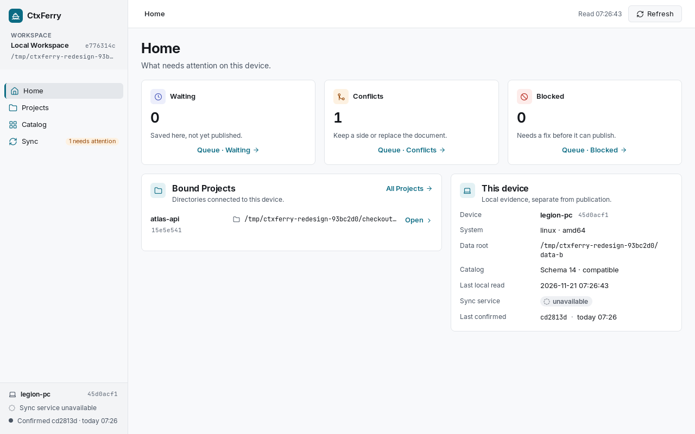
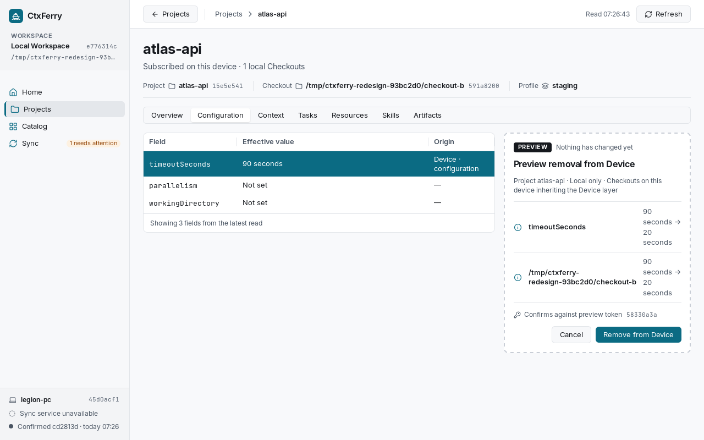
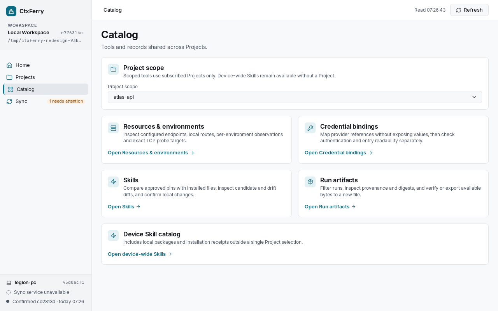
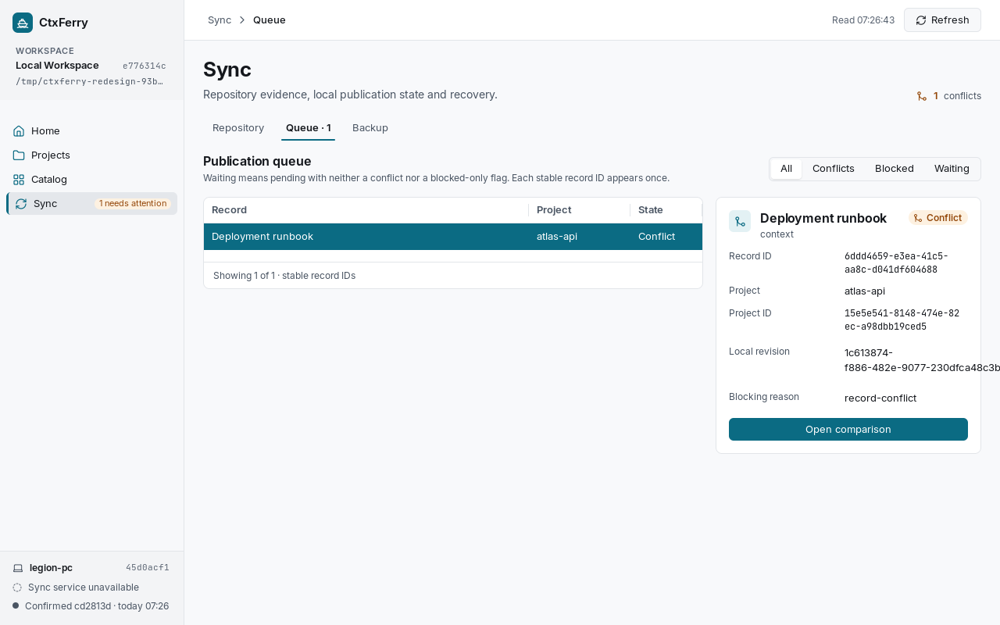

[English](../desktop.md) · 简体中文

CtxFerry 桌面应用只使用原生 MyGo 控件，打开与 CLI 相同的本地 Workspace。Home 回答哪些事项需要关注，Projects 解释 Project 在此设备上使用什么，Catalog 保存跨 Project 工具，Sync 显示哪些内容可以传到另一台设备。

## 启动应用

使用 MyGo Native UI 支持的桌面会话，以及与 `cmd/ctxferry-desktop/go.mod` 兼容的 Go 工具链：

```sh
cd cmd/ctxferry-desktop
go run .
```

窗口以 1280×800 启动，并支持 1024×680 的紧凑布局。紧凑布局使用图标栏，并将 Configuration、Conflict 和 Backup 确认保留在滚动页面之外的固定操作栏中。

要检查隔离的 Workspace，请为 CLI 和桌面应用设置相同数据根目录：

```sh
export CTXFERRY_DATA_DIR=/path/to/isolated-ctxferry
ctxferry init
cd /path/to/CtxFerry/cmd/ctxferry-desktop
go run .
```

桌面应用遵循 `CTXFERRY_DATA_DIR`；只向 CLI 命令传递 `--data-dir` 不会改变桌面位置。应用显示的每个 CLI 交接命令都会显式包含当前数据根目录。

## 打开或创建 Workspace

就绪检查会区分全新数据根目录、需要迁移的 catalog、较新的 schema 和无法读取的 catalog。

- **Create Workspace** 预览目标，并且只在确认后初始化本地 catalog。不会配置远程仓库，也不会上传任何内容。
- **Join a Workspace…** 生成带有可选 Project 订阅的 `ctxferry join` 命令。在终端中运行它并选择 Refresh。之后从 Projects 绑定 Checkout，使用解析到的 Project ID。
- 对于迁移或诊断，使用显示的 CLI 交接命令，然后选择 Refresh。桌面应用不会隐式迁移 catalog，也不会暴露原始数据库诊断。

刷新失败后，最后一次成功快照仍可见，但已过期。写入、Backup 和远程检查会保持锁定，直到成功重新读取。

## Home

Home 分别显示 **Waiting**、**Conflicts** 和 **Blocked** 数量。冲突不会同时被计入仅阻塞或等待。每个磁贴都会打开具有相应过滤条件的 Sync → Queue。

Bound Projects 卡片显示真实本地目录，并标记不可用路径。此设备分别显示 catalog 兼容性、本地读取时间、同步服务状态和最后确认的提交，不会与 Provider 或发布声明混为一谈。空 Workspace 会提供真实 `ctxferry project bind` 交接命令。



*示例 Workspace 中的 Home。Conflicts 磁贴打开队列，并筛选出需要决定的那一条记录。*

## Projects 和 Configuration

Projects 先按订阅状态分组，再按名称分组。未订阅 Project 保留其身份，并提供 `ctxferry project subscribe`；应用绝不会改用另一个可写目标。

已订阅 Project 的概览列出其本地 Checkout。更改已保存 Profile 前，先选择精确的 Checkout。Profile 变更在保存前显示受影响的 Checkout 和结果范围，保存后重新加载 Configuration、Context 和 Task 信任。

Configuration 提供：

- 有效值及其来源；
- 有序的 Workspace 默认、Project、Profile、Device 和 Checkout 贡献；
- 显式可写层及其共享或仅限本地的范围；
- 对受影响本地 Checkout、保留或继承值以及发布影响的预览；
- 与核心过期写入检查绑定的只读预览 ID；
- Written / Read back / Published 回执。

前三层是共享的。Device 和 Checkout 层保留在每台设备上，因此另一台设备可以在本地覆盖共享值，而此设备无法看到这些覆盖。共享写入先进入本地队列，直到某个已确认提交包含它。

Context 在列表、打开和分页时保持相同 Checkout 和解析到的 Profile。Task 通过该 Profile 解析 Resource 槽位。Task 分别显示映射的 Resource、精确 TCP 目标和最近针对该目标的观察时间，并与 Provider 身份验证和执行信任区分。Task → Resource 和 Task → Credential 链接保留调用范围，Back 会恢复该范围。



*此处移除 Device 覆盖仍只是预览。确认前，请检查受影响的 Checkout 及其将继承的值。*

## Catalog

Catalog 将四种工具连接到显式的已订阅 Project 范围：

- **Resources & environments：**配置的端点、本地覆盖、按环境划分的路由和观察，以及已确认的 TCP 探测。未知证据保持未知，尤其是其他设备的证据。
- **Credential bindings：**Project、Profile、Task 和要求范围，兼容的共享引用、Provider 定位器，以及独立的身份验证、条目可读性和可达性检查。Secret 值绝不会进入草稿、结果或复制的命令。
- **Skills：**已批准 pin、安装回执、候选项选择、安装/更新/回滚/恢复预览，以及逐文件 diff。发生漂移的文件同时提供 installed-to-local 漂移和 installed-to-candidate 比较。漂移在协调并重新扫描前会阻止确认。
- **Run artifacts：**运行/来源/内容筛选、来源信息、完整摘要、内容可用性和仅元数据说明。可用字节可以验证并导出为新文件。

设备级 Skill catalog 在没有 Project 时仍可使用。从 Project 进入的相关链接会自动提供其 ID，Back 恢复来源 Project 区域和选择。



*选择 atlas-api 后，Catalog 在该 Project 范围内打开每个工具。*

## Sync 和发布恢复

Sync 有三个区域：

- **Repository** 显示远程仓库、分支、已确认提交、历史大小、服务，以及最近的可达性/隐私检查。常规同步使用显式 `ctxferry sync` 交接命令。
- **Queue** 按稳定记录 ID 筛选 All、Conflicts、Blocked 和 Waiting 记录。检查修订证据、阻塞原因以及 Written / Read back / Published 状态。Conflicts 打开比较视图。
- **Backup** 在写入前检查来源/预检证据、新的绝对目标路径、固定数据范围、可选的本地数据、明文暴露和确认声明。

首次发布前，检查远程仓库可达且为私有，然后选择 **Review export…**。应用调用核心的真实预览操作，并显示其路径、大小和 SHA-256 摘要。另外检查原始共享文档和 Artifact Payload，排除粘贴进去的 Secret。最终 `ctxferry sync init --preview <id>` 交接命令只在分支不存在时创建配置分支；已推送历史无法召回。

如果首次发布丢失确认，Repository 会复用原始预览 ID。对于结果不确定的常规推送，它提供 `ctxferry sync` 一次性协调。Backup 和 Conflict 会保持锁定，直到 Refresh 确认日志已清除并重新读取已确认提交。

### 检查队列

从 Home 选择 **Queue · Conflicts** 打开筛选后的列表。选择记录，检查其修订证据并比较变更。

冲突解决会比较 base、local 和 remote 证据。可以保留完整一方、应用删除，或替换符合条件的 Context 内容。确认会说明后果并检查当前冲突令牌。过期比较必须重新加载并重新选择。回执标识新的本地修订，而不是已发布结果。



*在 Queue 中选择冲突记录，先检查其修订，再选择解决方案。*

## Backup 内容和恢复

每个备份都包含 Workspace 和共享 catalog 记录、共享 Context 和 Configuration、Skill pin 和来源、队列状态，以及存在时的已确认 Git 历史。只有选择单一的 local-only 选项时，才会包含仅限本地的绑定、覆盖、路由、观察、订阅、运行记录和可用 Artifact 字节。

Provider 持有的凭据值、Provider 会话、Git 身份验证和执行信任绝不包含在内。Skill 安装回执和已安装 Skill 文件也被排除。

备份是明文。Context、Configuration、Skill 来源和 Git 历史可能包含嵌入的 Secret，因此请检查原始内容，而不是只依赖 manifest。回执标识目标、`manifest.json`、catalog SHA-256、包含范围和源快照。[恢复](recovery.md)提供恢复命令和必需参数。

## 验证和原生截图

运行仓库和桌面测试套件：

```sh
go test ./...
cd cmd/ctxferry-desktop
go test ./...
go test -tags ctxferry_test ./...
```

原生截图场景通过真实 CLI/核心操作创建隔离数据，并在两种支持的尺寸下驱动运行中的 MyGo 窗口：

```sh
python3 capture_redesign.py /tmp/ctxferry-redesign-<revision> --revision <full-sha>
```

最终实现评审、数据状态、22 张生产界面截图和独立 K3.1 Pro 评审发现记录在[原生桌面重设计实现评审](https://github.com/whynpc9/CtxFerry/blob/2b43bdd/docs/development/desktop/review-native-redesign.md)中。
