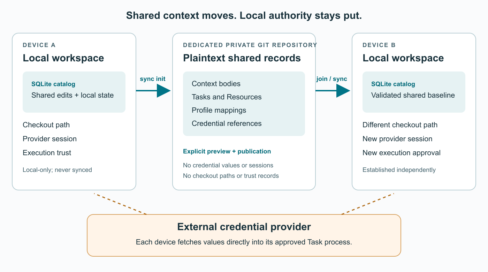

[English](../tutorial.md) · 简体中文

本演练围绕名为 `atlas-api` 的 Go 服务构建一套完整、典型的 CtxFerry 工作流。你将注册 Project 指令，运行本地测试 Task，将集成 Task 连接到数据库凭据，发布共享 catalog，并在第二台设备上复现该 Task。

示例使用 Infisical US Cloud 作为凭据引用。本地步骤不需要账户或网络。同步和凭据步骤是显式操作，需要你自己的私有 GitHub 仓库、数据库和 Provider 条目。



关键区别在于，CtxFerry 同步的是**开发上下文和凭据引用**。它不会复制检出目录、同步 SQLite 文件、共享 Provider 登录，或把凭据值放入 Git。

## 准备工作

- Go 1.27.4 或更新的兼容版本，以及 Git。
- 一个 Go 项目的现有 Git 检出目录。示例假设普通测试通过 `go test ./...` 运行，集成测试使用 `integration` build tag；请根据项目调整参数。
- 带凭据步骤需要一个**一次性开发数据库**、其非 Secret 主机和端口，以及允许读取一个连接字符串条目的 Infisical Universal Auth 身份。不要从生产数据开始。
- 双设备步骤需要一个空的专用**私有 GitHub 仓库**，以及两台设备上都可用的 Git 和 GitHub 元数据身份验证。

Shell 示例使用 POSIX 语法。将每个 `<angle-bracket>` 值替换为来自你自己的输出或服务的值。输出快照经过删减；UUID、修订、时间戳、路径和哈希会有所不同。

## 1. 安装并初始化第一台设备

从 CtxFerry 源码检出目录安装 CLI：

```sh
go install ./cmd/ctxferry
ctxferry --help
```

如果 Go 二进制目录不在 `PATH` 中，使用 `go env GOBIN` 和 `go env GOPATH` 定位。然后初始化本地 Workspace：

```sh
ctxferry init --format json
```

响应包含 `data.workspace`、`data.device` 和 `created: true`。这会创建本地 catalog 和稳定身份，不会联系 GitHub 或凭据 Provider。重复 `init` 会保留身份并返回 `created: false`。

## 2. 绑定检出目录并记录其 ID

进入项目检出目录，将其绑定到逻辑 Project：

```sh
cd /path/to/atlas-api
ctxferry project bind . --slug atlas-api --format json
ctxferry project inspect --format json
```

成功绑定具有以下结构：

```json
{
  "schemaVersion": 1,
  "ok": true,
  "data": {
    "project": { "id": "<project-uuid>", "slug": "atlas-api" },
    "binding": {
      "path": "/path/to/atlas-api",
      "membershipId": "<membership-uuid>",
      "repositoryId": "<repository-uuid>"
    },
    "created": true
  },
  "error": null
}
```

复制 membership 和 Repository ID 供后续步骤使用。Membership 将 Project 连接到源码 Repository 中的一个范围；Task 使用它查找工作目录。绑定本身及其绝对路径保留在此设备上。CtxFerry 不会向你的源码检出目录添加文件。

`project inspect` 应报告 `resolution.source: "path-binding"` 和当前检出目录。之后从此检出目录运行的命令无需显式 `--project` 参数即可解析 `atlas-api`。

## 3. 添加共享指令和 local-only 笔记

创建名为 `development.md` 的 UTF-8 Markdown 文件，内容应适合放入私有 GitHub 仓库：

```md
# Development workflow

Run `go test ./...` before publishing a change.
The integration database contains disposable test data only.
Use the registered integration-check Task instead of pasting its connection
string into a shell or agent session.
```

将其注册为允许向代理完整披露的共享 Context：

```sh
ctxferry context put \
  --title 'Development workflow' \
  --purpose project-summary \
  --source 'Atlas maintainers' \
  --summary 'Build, test, and integration database conventions' \
  --body-file /path/to/development.md \
  --storage shared --disclosure full --format json
```

将 `data.document.id` 保存为 `<shared-document-uuid>`。回执包含元数据和修订，不包含文档正文。

现在创建第二个 Markdown 文件 `private-notes.md`，使用不同的存储策略注册：

```sh
ctxferry context put \
  --title 'Private launch notes' \
  --purpose notes \
  --source 'Local maintainer' \
  --summary 'Notes that must not leave this device' \
  --body-file /path/to/private-notes.md \
  --storage local-only --disclosure full --format json
```

将此 ID 保存为 `<local-document-uuid>`。然后像代理一样检查 Project：

```sh
ctxferry context show --format json
ctxferry context get <shared-document-uuid> --format json
ctxferry context search 'integration database' --format json
```

`show` 快照应包含两个文档索引和共享 Project 摘要，但不包含文档正文：

```text
summary: Build, test, and integration database conventions
documents:
  - Development workflow    storage: shared      disclosure: full
  - Private launch notes    storage: local-only  disclosure: full
truncated: false
```

`get` 返回共享正文，因为其披露为 `full`；`show` 仍只返回索引。存储与披露相互独立：即使 `shared` 文档的代理披露只有 `summary` 或 `reference`，其完整正文仍可进行明文发布。

## 4. 注册并运行无凭据 Task

使用第 2 步的 membership ID 注册 Task。每个参数都是独立的 `--arg`；CtxFerry 不会解析 shell 命令字符串。

```sh
ctxferry task add unit-tests \
  --purpose 'Run the Go unit tests' \
  --membership <membership-uuid> \
  --working-directory . \
  --program go --arg=test --arg=./... \
  --storage shared --format json
```

检查并运行：

```sh
ctxferry task inspect unit-tests --format json
ctxferry run unit-tests --format jsonl
```

成功运行会产生开始事件、转发的输出和最终子进程结果：

```jsonl
{"type":"start","taskId":"<task-uuid>","task":"unit-tests"}
{"type":"stdout","data":"ok  \texample.com/atlas-api\t0.457s\n"}
{"type":"result","origin":"child","exitCode":0,"truncated":false}
```

此 Task 不需要 Provider 身份验证或执行信任批准。其工作目录来自已绑定 Repository membership，而不是任意调用方目录。子进程失败会保留自己的退出码；CtxFerry 控制面失败改用 `origin: "control-plane"`。

## 5. 描述数据库和集成 Task

注册数据库的非 Secret 端点。将示例主机替换为真实开发端点；不要在 `--endpoint` 中放入用户名、密码或连接字符串。

```sh
ctxferry resource add \
  --identity dev-db --kind database --stage dev \
  --purpose 'Disposable integration-test database' \
  --storage shared --endpoint db.example.com:5432 --format json
```

将 `data.id` 保存为 `<resource-uuid>`。如果此设备通过本地转发访问该逻辑服务，请添加设备本地路由：

```sh
ctxferry resource route <resource-uuid> \
  --endpoint localhost:15432 --format json
```

该路由不会替换共享端点或其他设备的路由。接下来，注册具有一个 Resource 槽位和一个凭据要求的集成 Task：

```sh
ctxferry task add integration-check \
  --purpose 'Run integration checks against disposable data' \
  --membership <membership-uuid> \
  --working-directory . \
  --program go --arg=test --arg=-tags=integration --arg=./... \
  --storage shared \
  --resource-slot '{"name":"db","kind":"database","stage":"dev"}' \
  --credential-requirement '{"name":"login","resourceSlot":"db","purpose":"integration-tests","type":"connection-string","env":"DATABASE_URL"}' \
  --format json
```

这表示 `integration-check` 需要一个开发数据库，以及一个通过 `DATABASE_URL` 交付的连接字符串。它没有指定后端条目，也不包含凭据值。

## 6. 将要求连接到精确的 Provider 条目

创建 Profile，将 Task 的 `db` 槽位映射到已注册 Resource，并为此检出目录选择 Profile：

```sh
ctxferry profile create development --format json
ctxferry profile map-resource development integration-check db \
  <resource-uuid> --format json
ctxferry profile select development --format json
```

创建共享凭据引用。将后端 Project、环境、文件夹和键替换为包含开发连接字符串的精确 Infisical 条目：

```sh
ctxferry secret bind integration-check login --profile development \
  --alias integration-db \
  --provider infisical --provider-profile team --method universal-auth \
  --backend-project <infisical-project-id> \
  --environment dev --path /atlas-api --key ATLAS_DB_URL \
  --format json
```

后端键 `ATLAS_DB_URL` 刻意独立于子进程变量 `DATABASE_URL`。命令创建 SecretBinding 元数据和显式 Profile 映射；既不读取也不存储条目的值。

```sh
ctxferry secret list --format json
ctxferry task inspect integration-check --format json
```

列表快照包含 Provider Profile 和定位器，但不包含值：

```text
alias: integration-db
providerProfile: infisical / team / universal-auth
locator: <infisical-project-id> / dev / /atlas-api / ATLAS_DB_URL
resourceId: <resource-uuid>
purpose: integration-tests
type: connection-string
```

## 7. 在设备 A 上进行身份验证、评审信任并运行

通过现有受保护启动器提供 `INFISICAL_CLIENT_ID` 和 `INFISICAL_CLIENT_SECRET`。在此次调用具有这些变量的情况下，运行：

```sh
CTXFERRY_INFISICAL_PROFILE=team \
  ctxferry provider login infisical \
  --provider-profile team --method universal-auth --format json
```

CtxFerry 将生成的访问令牌存入此设备的操作系统凭据存储。它不会写入明文令牌文件，也不会同步会话。个人身份验证、无头令牌注入或 Bitwarden 使用[凭据](credentials.md)中的 Provider 特定流程。

分别检查 Resource 和精确 Provider 条目：

```sh
ctxferry resource check <resource-uuid> --format json
ctxferry secret status integration-check login \
  --profile development --format json
```

`resource check` 执行两秒 TCP 探测；它不能证明数据库协议或登录可用。可达探测和成功 Provider 读取后，`data` 中的事实应包括：

```json
{
  "bound": true,
  "authenticated": true,
  "entryRetrievable": true,
  "resourceReachable": true
}
```

此报告不包含凭据值。`null` 事实表示未知，不是检查成功。

首次带凭据运行前，预览精确执行定义：

```sh
ctxferry task trust preview integration-check \
  --profile development --format json
```

至少检查 `definition.program`、`definition.argv`、`checkoutRoot`、`workingDirectory`、Resource 映射和每个凭据定位器。初始 `data.state` 为 `not-enabled`。启用与已检查预览完全一致的定义：

```sh
ctxferry task trust enable integration-check --profile development \
  --preview <preview-token> --format json
```

从 `data.preview` 复制 `<preview-token>`，不要使用 Task 修订。然后运行：

```sh
ctxferry run integration-check --profile development --format jsonl
```

子进程获得最小基础环境和 `DATABASE_URL`，而不是你的完整 shell 环境、Git 身份验证或 Provider 令牌。CtxFerry 将转发输出中识别到的交付值替换为 `[REDACTED]`。子进程仍可读取、编码、打印或传输该值：Task 不是操作系统安全边界。

## 8. 检查并发布共享 catalog

按照[私有同步](sync.md#启用并验证私有目标)准备 Git 身份验证和 GitHub 元数据身份验证。然后在不上传任何内容的情况下验证专用目标：

```sh
ctxferry sync enable \
  --remote git@github.com:<owner>/atlas-context.git --format json
```

只有 `data.state` 为 `"enabled"`，且 `data.check` 同时报告 `gitReachable: true` 和 `privacy: "private"` 时才继续。未经验证的结果不授权发布。

预览精确导出：

```sh
ctxferry sync preview --format json
```

检查每个 `data.files` 路径和原始共享源材料。保存 `data.previewId`。导出包括共享 Context 正文、Resource 和 Task 定义、Profile 映射，以及 SecretBinding 的定位器。它排除 local-only 笔记、Checkout 绑定和路径、本地路由和观察、Profile 选择、执行信任、Provider 会话和凭据值。仓库历史会保留已发布明文，包括后来删除的内容。

批准该精确快照后，初始化同步分支：

```sh
ctxferry sync init --preview <preview-id> --format json
ctxferry sync status --format json
```

首次成功发布返回 `data.state: "synced"`、已确认的 `data.head`，最终状态中 `pending: 0`。预览后的任何共享变更都会使其过期；请重新预览，不要强制发布。

## 9. 从设备 B 加入并运行

在第二台设备上安装相同 CLI，并准备 Git/GitHub 身份验证。从全新的 CtxFerry 数据根目录开始。不要复制设备 A 的 SQLite catalog、WAL 文件、锁、受管理 Git 仓库或凭据存储，也不要先运行 `init` 创建独立 Workspace。

加入现有 Workspace 并订阅 Project：

```sh
ctxferry join git@github.com:<owner>/atlas-context.git \
  --subscribe atlas-api --format json
ctxferry project list --format json
```

进入设备 B 自己的源码检出目录，将其绑定到已同步 Project 和 Repository：

```sh
cd /path/to/device-b/atlas-api
ctxferry project bind . --project atlas-api \
  --repository <repository-uuid> --format json
ctxferry project inspect --format json
ctxferry profile select development --format json
```

现在 Project、Repository、membership、Task、Resource 和 SecretBinding ID 与设备 A 匹配。Device ID 和 Checkout 路径不同且保留在本地。无需登录 Infisical，即可检查已同步上下文：

```sh
ctxferry context show --format json
ctxferry context get <shared-document-uuid> --format json
ctxferry task inspect integration-check --format json
ctxferry secret list --format json
```

加入后，共享文档和凭据**引用**可以离线使用，local-only 笔记不可用。以下预期失败说明存储策略已生效：

```sh
ctxferry context get <local-document-uuid> --format json
# error.code: document-not-found
```

设备 B 必须建立自己的网络证据、Provider 身份验证和执行信任。如果使用本地转发，先设置自己的路由：

```sh
ctxferry resource route <resource-uuid> \
  --endpoint localhost:25432 --format json
```

然后进行身份验证并检查当前状态：

```sh
CTXFERRY_INFISICAL_PROFILE=team \
  ctxferry provider login infisical \
  --provider-profile team --method universal-auth --format json
ctxferry resource check <resource-uuid> --format json
ctxferry secret status integration-check login \
  --profile development --format json
ctxferry task trust preview integration-check \
  --profile development --format json
```

信任预览必须再次从 `not-enabled` 开始：设备 A 的批准没有同步。检查设备 B 解析出的路径和相同执行字段，然后启用并运行：

```sh
ctxferry task trust enable integration-check --profile development \
  --preview <device-b-preview-token> --format json
ctxferry run integration-check --profile development --format jsonl
```

后续共享编辑先在编辑设备上运行 `ctxferry sync --format json`，再在另一台设备上运行。同步离线时，本地读取仍可用；`sync status --format json` 区分 pending、offline、conflict 和 synced 状态。

## 概念验证检查清单

满足以下全部条件时，你已经验证了核心产品承诺：

| 预期 | 本教程中的证据 |
| --- | --- |
| 本地优先上下文 | 初始化、绑定、Context 读取和单元 Task 在同步或 Provider 登录前即可工作。 |
| 渐进式披露 | `context show` 只索引文档而不包含正文；`context get` 只返回披露允许的内容。 |
| 可重复执行 | 两台设备从各自绑定的检出目录，运行相同 Task 和参数数组。 |
| 显式凭据解析 | Task 要求、Profile 映射、Resource 和精确 Provider 定位器一致；不会猜测相似条目。 |
| 设备本地安全决策 | 每台设备分别执行 Provider 登录、Resource 观察和执行信任批准。 |
| 有意的明文同步 | 首次上传要求仓库验证和精确预览；local-only 笔记绝不会到达设备 B。 |
| 不传输 Secret 值 | `secret list`、`secret status`、同步记录和输出快照包含引用和事实，不包含连接字符串。 |

要从 CtxFerry 源码检出目录检查对应实现路径，请运行：

```sh
go test -count=1 ./tests \
  -run '^(TestFirstPrivatePublish|TestTwoDeviceSync|TestCredentialedRun)$'
```

这些集成测试使用隔离的本地 Git 传输和模拟 Provider；它们不能替代上述真实 GitHub、数据库和 Infisical 检查。更改实现前运行完整测试套件：

```sh
go test -count=1 ./...
go vet ./...
```

更深入的参考请继续阅读 [Context](context.md)、[Resource 和 Task](tasks-and-resources.md)、[凭据](credentials.md)和[私有同步](sync.md)。
